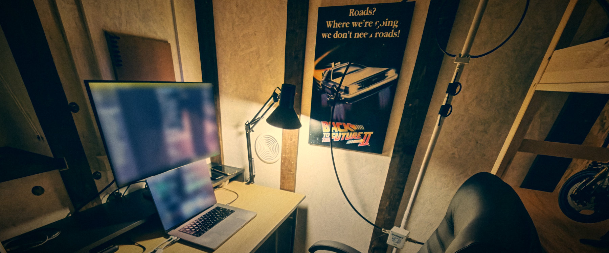

Hi, I'm Yevhen, a software engineer from Ukraine. I work at
[Conductor](https://www.conductor.com/), and have been there for more than 11 years. In my own time I make Android apps and an open course
on radio and electronics, and I'm a radio amateur, call sign **[UT3UVC](https://www.qrz.com/db/UT3UVC)**.

### Things I make

<table>
<tr>
<td width="72" align="center"></td>
<td>
<b><a href="https://jemcik.github.io/JemRec/">JemRec</a></b>: a call recorder for unrooted Android. Phone, WhatsApp, Telegram, Viber and Google Meet calls, both sides, and an answering machine that takes a message when you can't answer. No root, no Shizuku, no computer. 
<a href="https://f-droid.org/packages/com.jemcik.jemrec/">F-Droid</a> · <a href="https://www.youtube.com/watch?v=v5JV6KUUj_I">What it does, in a video</a> · <a href="https://github.com/jemcik/JemRec">Code</a>
</td>
</tr>
<tr>
<td align="center"></td>
<td>
<b><a href="https://radiobench.dev/">The Radio Bench</a></b>: an interactive, open course on radio and electronics, from zero to confident. For radio amateurs who want to understand how it works, not only pass the exam. 
<a href="https://radiobench.dev/">radiobench.dev</a> · <a href="https://github.com/jemcik/the-radio-bench">Code</a>
</td>
</tr>
<tr>
<td align="center"></td>
<td>
<b><a href="https://jemcik.github.io/Gloaming/">Gloaming</a></b>: one switch for the whole night. Do Not Disturb and the screen effects turn on by themselves, on the schedule you set, with the app closed. 
<a href="https://play.google.com/store/apps/details?id=com.jemcik.gloaming">Google Play</a> · <a href="https://github.com/jemcik/Gloaming">Code</a>
</td>
</tr>
</table>

Smaller things: a [Morse keyboard](https://github.com/jemcik/arduino-morse-keyboard)
that turns an Arduino and a paddle key into a USB keyboard you type on in Morse,
and a [car game](https://github.com/jemcik/arduino-car-game) for the 16x2 LCD
from the Arduino Starter Kit.

### Elsewhere

[QRZ.com](https://www.qrz.com/db/UT3UVC) · [YouTube](https://www.youtube.com/@jemcik) · [Support my work on Donatello](https://donatello.to/jemcik)

73!
